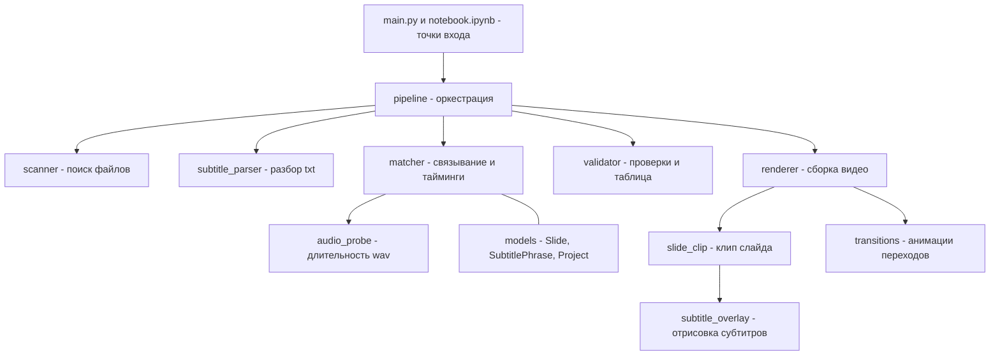

<div align="center">

# 🎬 video_maker_no_ai

**Генератор видео из слайдов, аудио и субтитров — полностью оффлайн**

Превращает набор изображений, WAV-дорожек и текстовых субтитров в готовый ролик.
Работает без интернета и облачных API — для закрытого банковского контура.

[]()
[]()
[]()
[]()
[]()

</div>

---

## 📑 Навигация

| Раздел | Что внутри |
|--------|-----------|
| ✨ [Возможности](#-возможности) | Что умеет генератор |
| ⚙️ [Как это работает](#️-как-это-работает) | Пайплайн scan → match → validate → render |
| 📁 [Входные данные](#-входные-данные) | Структура папки и формат субтитров |
| 🚀 [Установка и запуск](#-установка-и-запуск) | Консоль и Jupyter-ноутбук |
| 🎛️ [Параметры](#️-параметры) | Настройки видео, субтитров и переходов |
| 🏗️ [Архитектура](#️-архитектура) | Диаграмма, структура папок, принципы |
| 🔐 [Перенос в закрытый контур](#-перенос-в-закрытый-контур) | Zip-архив и оффлайн-установка |

---

## ✨ Возможности

- 🖼️ **Слайды из изображений** — JPG, JPEG, PNG (регистр расширения не важен: `.jpg` = `.JPG`).
- 🔊 **Опор на звук** — каждый слайд показывается ровно столько, сколько длится его аудиодорожка.
- 💬 **Субтитры в одну строку** — сменяются по времени, с настраиваемым шрифтом, размером, цветом и позицией.
- ⏱️ **Два формата тайминга субтитров:**
  - с явными тайм-кодами `[mm:ss]`;
  - без тайм-кодов — время распределяется равномерно по длине аудио;
  - *форматы можно смешивать внутри одного слайда.*
- 🎞️ **Анимации переходов** между слайдами: `none`, `fade`, `crossfade`, `slide_left`.
- ✅ **Проверка перед сборкой** — сводная таблица соответствий и предупреждения о несостыковках.
- 🖥️ **Два способа запуска** — консоль (`main.py`) и Jupyter-ноутбук (`notebook.ipynb`).
- 📦 **Перенос одним zip** — готовый архив для локальной установки в закрытом контуре.

**Поддерживаемые форматы:** изображения — JPG/JPEG/PNG · аудио — WAV · вывод — MP4.

> Планы на будущее: фоновая музыка, вотермарк, многострочные субтитры, обводка текста, больше анимаций.

---

## ⚙️ Как это работает

```
📂 Папка проекта        🔍 Scan            🔗 Match           ✅ Validate         🎬 Render
   slide_1.jpg    ────▶   поиск     ────▶   связывание  ────▶   сводная     ────▶   сборка
   audio_1.wav            jpg/wav/txt       по номеру            таблица             MP4
   subtitles.txt          по номеру         + тайминги           + проверки
```

| Этап | Модуль | Что делает |
|------|--------|-----------|
| 1 | `scanner` | Поиск jpg/wav/txt, извлечение номера слайда из имени |
| 2 | `matcher` | Связывание `slide_N` + `audio_N` + блок «Слайд N», расчёт таймингов |
| 3 | `validator` | Печать сводной таблицы и предупреждений о несостыковках |
| 4 | `renderer` | Сборка клипов, наложение субтитров, переходы, экспорт MP4 |

---

## 📁 Входные данные

```
input/
└── Ролик/
    ├── slide_1.jpg      🖼️ изображения слайдов
    ├── slide_2.jpg
    ├── audio_1.wav      🔊 аудиодорожки
    ├── audio_2.wav
    └── subtitles.txt    💬 субтитры
```

🔗 **Связывание** — по номеру в имени файла: `slide_1` ↔ `audio_1` ↔ блок «Слайд 1».

### 📝 Формат `subtitles.txt`

**Вариант 1 — с явными тайм-кодами.** `[mm:ss]` — момент появления фразы от начала слайда:

```
Слайд 1
[00:00] Первое предложение субтитра.
[00:03] Второе предложение.
```

**Вариант 2 — без тайм-кодов.** Каждая строка — отдельная фраза, время делится равномерно:

```
Слайд 1
День добрый, Коллеги.
Первое предложение субтитра.
Второе предложение.
```

> 💡 Форматы можно смешивать: фразы без тайм-кода равномерно заполняют промежутки между явными.

---

## 🚀 Установка и запуск

### Требования
- **Python** 3.14 (работает и на 3.11+)
- Зависимости из `requirements.txt` (FFmpeg поставляется внутри через `imageio-ffmpeg`)

### Установка

```bash
pip install -r requirements.txt
```

### Запуск через консоль

```bash
# Базовый запуск
python main.py --project "input/Ролик" --output "output/Ролик.mp4"

# С настройкой перехода
python main.py --transition fade --transition-duration 0.7

# С настройкой субтитров
python main.py --font-size 56 --subtitle-position bottom
```

### Запуск через ноутбук

Откройте [`notebook.ipynb`](notebook.ipynb) — параметры в первой ячейке, запуск пайплайна во второй.

---

## 🎛️ Параметры

Задаются в [`config/default_config.py`](config/default_config.py) или переопределяются флагами CLI.

| Параметр | CLI-флаг | По умолчанию |
|----------|----------|--------------|
| Разрешение | `--width` / `--height` | `1920 × 1080` |
| Частота кадров | `--fps` | `30` |
| Размер шрифта | `--font-size` | `48` |
| Позиция субтитров | `--subtitle-position` | `bottom` |
| Тип перехода | `--transition` | `crossfade` |
| Длительность перехода | `--transition-duration` | `0.5` |

### 🎞️ Анимации переходов

| Тип | Эффект |
|-----|--------|
| `none` | Резкий срез без анимации |
| `fade` | Затемнение в чёрный |
| `crossfade` | Плавное перетекание кадров |
| `slide_left` | Сдвиг следующего слайда влево |

---

## 🏗️ Архитектура

Проект построен по принципам **SOLID / DRY / KISS**. Каждый модуль имеет единую ответственность,
файлы не превышают 200 строк. Переходы реализованы по паттерну **Стратегия** — новые добавляются
без изменения существующего кода (Open/Closed).

### Граф архитектуры



**Как читать:** стрелки — зависимости. `pipeline` оркеструет этапы, не содержа бизнес-логики.
Модели данных (`models`) — общий контракт между модулями.

### Структура папок

```
video_maker_no_ai/
├── main.py                 # точка входа CLI
├── notebook.ipynb          # точка входа Jupyter
├── make_release.py         # сборка zip для закрытого контура
├── requirements.txt        # зависимости
├── README.md               # этот файл
├── .gitignore
├── config/
│   └── default_config.py   # все параметры
├── src/
│   ├── pipeline.py         # scan → match → validate → render
│   ├── scanner.py          # поиск jpg/wav/txt
│   ├── subtitle_parser.py  # разбор txt (оба формата)
│   ├── audio_probe.py      # длительность wav
│   ├── matcher.py          # связывание + тайминги
│   ├── validator.py        # сводная таблица + проверки
│   ├── models.py           # модели данных
│   ├── rendering/          # клипы, субтитры, переходы, экспорт
│   └── utils/              # тайм-коды, логирование
├── input/                  # входные данные (не версонируются)
└── output/                 # готовые видео (не версонируются)
```

---

## 🛠️ Технологии

| Назначение | Технология |
|------------|-----------|
| Язык | [Python](https://www.python.org/) 3.14 |
| Сборка видео | [MoviePy](https://zulko.github.io/moviepy/) 2.2 |
| Отрисовка субтитров | [Pillow](https://python-pillow.org/) |
| Численные операции | [NumPy](https://numpy.org/) |
| FFmpeg (встроенный) | [imageio-ffmpeg](https://github.com/imageio/imageio-ffmpeg) |
| Длительность аудио | встроенный модуль `wave` |

---

## 🔐 Перенос в закрытый контур

### Вариант A — готовый zip

```bash
python make_release.py
```

Создаёт `dist/video_maker_no_ai_v1.0.zip` со строго необходимым набором файлов для локальной
установки (исходники, config, точки входа, requirements, README — без тестов, кэша и медиа).
Передаётся по почте.

### Вариант B — wheels для оффлайн-установки

```bash
# На машине с интернетом
pip download -r requirements.txt -d wheels

# В закрытом контуре
pip install --no-index --find-links wheels -r requirements.txt
```

> ✅ FFmpeg уже внутри (через `imageio-ffmpeg`) — внешних бинарных зависимостей нет.

---

## 📬 Контакты

Автор проекта — **Кривоносов Денис**

Связь по вопросам и предложениям: **dchamel@yandex.ru**

---

<div align="center">

**🎬 video_maker_no_ai v1.0**

Сделано с 🐍 Python и ❤️ для закрытого контура

</div>
